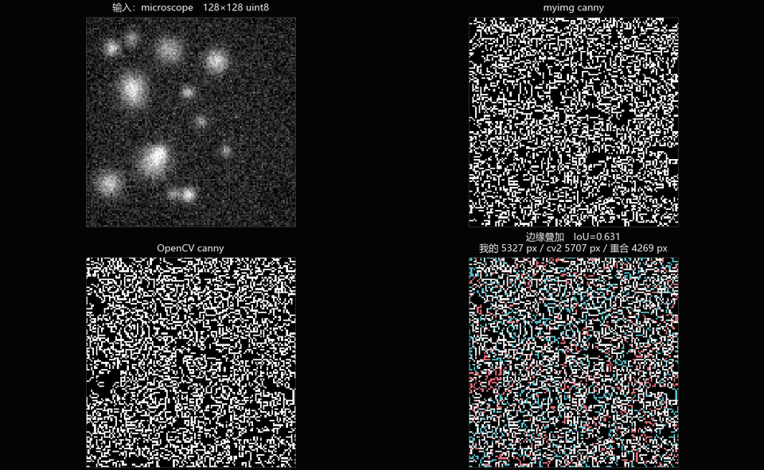

# myimg

[](https://github.com/wanzi-qz/wanzi-myimg/actions/workflows/ci.yml)

纯NumPy手写常用图像处理算子，逐个与 OpenCV/scikit-image 对拍，把误差、耗时、差异原因都记下来。

> 📖 完整产品使用说明（背景 / 原理 / 操作 / 结果解释 / FAQ）：[docs/user_guide.md](docs/user_guide.md)
>
> 🌐 在线试用（浏览器直接跑，不用装环境）：**[wanzi-myimg.streamlit.app](https://wanzi-myimg.streamlit.app/)**

## 为什么做这个

有些图像算子属于会调、但是说不清里面在算什么。
这个仓库就是把它们拆开重写：高斯滤波到底怎么卷的、Otsu 的类间方差在遍历什么、
Canny的非极大值抑制为什么要对幅值插值。写完再跟工业标准库对拍，
误差对不上就必须找到原因，不用差不多就行糊过去。
目的是把每个算子的原理和实现细节弄清楚。

## 目录

```
myimg/            算子实现（手写区，只允许 numpy + 标准库）
  _core.py        dtype 归一、边界填充、输入校验（基础设施，已写好）
  filters.py      高斯 / 均值 / 中值滤波
  histogram.py    Otsu 阈值 / 直方图均衡 / CLAHE
  edges.py        Sobel / Canny 简化版
  morphology.py   腐蚀膨胀开闭 / 连通域标记
tests/            pytest：契约测试 + 与 OpenCV 的数值对拍
benchmarks/       对拍运行器与报告模板（cv2 / skimage 只在这里当基准）
  cases.py        12 个固定种子合成用例（含荧光显微合成图）
  refs.py         基准封装，所有口径换算集中在这一个文件
  run_compare.py  跑对拍 -> out/compare.md + compare.json + 对比图
  report_template.md  机器出数字、人写归因，各占一半
examples/cli.py   命令行入口（PIL 只读写图片，碰不到任何算子数值）
gui/              可视化对拍台（Tkinter + matplotlib，应用层，允许用 cv2 当基准）
  params.py       每个算子在界面上暴露哪些可调项（唯一事实源）
  engine.py       调 myimg / OpenCV；误差与判定复用 benchmarks，不重写口径
  render.py       2x2 四格渲染，右下信息格看「差在哪、差多少」
  app.py          窗口 / 控件 / 事件；python -m gui 启动
  theme.py        暗金主题色板 + 判定用色（web 版共用）
  anim.py         扫描 GIF 的组帧与并帧（web 版共用）
web/              浏览器版对拍台（Streamlit，同一套 engine / render / 口径）
  app.py          streamlit run web/app.py 启动；侧栏选算子，主区四格 + 扫描
tools/            gui_main.py（exe 入口，认 --selftest 自检）+ build_exe.py（打包脚本）
notes/            报错本、默写记录
data/             真实图片放这里（已 gitignore，只留 README）
PROGRESS.md       验收清单 + 面试复述清单
```

## 手写纪律

1. `myimg/` 下的算子文件**禁止** import `cv2` / `scipy.ndimage` / `skimage`。库只允许出现在
   `tests/`、`benchmarks/`、`gui/` 里当基准（`examples/cli.py` 的 PIL 只负责读写图片，不参与数值）。
   后三者是应用层：基准和界面本来就该用工业库；`myimg/` 里这一条破了，
   「手写 NumPy 实现」这个说法就不成立了。
2. 每个函数**先写能跑的版本**（双层 for 循环也行），测试转绿之后再改写向量化。
   两版都保留，耗时差写进报告——这本身就是报告里的一节。
3. 对不上的误差不跳过，去 `benchmarks/report_template.md` 的「差异归因」里写清楚原因。
4. 每写完一个算子，48 小时内合上资料默写一遍核心实现，记到 `notes/默写记录.md`。
   默不出来 = 没会，回去重写。

## 快速开始

```bash
pip install -e ".[dev]"

pytest -q                       # 全部：未实现的显示 xfail，实现错的显示 failed
pytest tests/test_filters.py -k gaussian   # 单个算子
python benchmarks/run_compare.py --all --figures   # 误差表+耗时表+对比图
python examples/cli.py demo canny --case microscope --sigma 1.4 -o out.png
python -m gui                     # 可视化对拍台（见下节）

pip install -e ".[web]"           # 只多装一个 streamlit
streamlit run web/app.py          # 浏览器版对拍台（同一套计算核，见下节）
pip install -e ".[pack]"
python tools/build_exe.py         # 打 dist/myimg-gui.exe（体积与 venv 见下节）
```

报告在 `benchmarks/out/compare.md`：误差表、耗时表、差异归因、已核对的口径事实四节。
每个数字都能在 `compare.json` 里找到出处；人写的那一半用 `benchmarks/report_template.md`。

测试结果的三种状态是有意的：

| 状态 | 含义 |
|---|---|
| `xfailed` | 函数体还是 `NotImplementedError`，没开始写 |
| `failed` | 写了，但和基准对不上——去查边界处理、核归一化、dtype |
| `passed` | 对上了，可以去默写一遍 |

## 可视化对拍台（GUI）

```bash
python -m gui
```

Tkinter + matplotlib，零额外依赖（tkinter 是标准库，matplotlib 已在 dev 依赖里）。
界面分四块：顶部工具条（用例 / 尺寸 / 打开本地图片 / 导出）、左侧算子树 +
动态参数滑块 + 实现变体（vector / naive / 积分图）、右侧 2×2 画布、底部状态区
（误差 / 耗时 / 口径说明 / 坑提示）。配色对齐个人站 wanzi.me 的设计变量：
黑底 `#070707` + 强调金 `#d8b46a`，matplotlib 信息格走同一套暗色 rcParams，
导出 PNG 与屏幕同色。左栏「参数扫描」卡任选一个参数点与帧数，开始后画布
逐帧刷新放动画，结束在状态区给出这一轮的取值区间与空帧说明；帧顺路按 960 宽
缓存，扫完（或中途停止）点「存 GIF」导出循环动图；导出时宽度（480/720/960）
与抽帧（隔 k 帧取一帧）可选，帧间隔随抽帧倍数放大，播放速度仍接近扫描实时。
调色板由全帧马赛克 + 主题标准色块统一量化，不闪也不碾彩线。




设计上有两条硬规矩：

1. **判定口径不重写**。界面上的「逐像素精确 / 超出容差 / 仅记录」全部走
   `benchmarks.run_compare.compare_one`，和 compare.md 是同一套代码算出来的，
   不允许出现「报告说通过、界面说不通过」。
2. **右下信息格是重点**。前三格看效果，第四格看「差在哪、差多少」：
   边缘叠加（红=仅我的、青=仅 cv2、白=重合）、差值热图、Otsu 直方图带阈值线、
   均衡化 CDF、连通域面积柱状 + 质心误差。参数改完 150ms 防抖自动重跑。

回归测试在 `tests/test_gui_engine.py`：参数表 key 与 myimg 签名逐条对齐、
全算子 × 默认参数 engine 不抛异常、全信息格视图 render 不崩（Agg 后端，不弹窗）；
扫描取值序列（choice 原序 / 舍入去重 / odd 保奇 / steps 兜底）与暗色主题色token
也各有回归项，全仓 796 条测试全绿。

## Web 对拍台（Streamlit）

```bash
pip install -e ".[web]"
streamlit run web/app.py
```

桌面版能干的事这里都能干，区别只是跑在浏览器里：侧栏选分组 / 算子 / 变体 / 用例 /
尺寸，也能上传本地图；主区一行信息格下拉（边缘叠加 / 差值热图 / Otsu 直方图 /
均衡 CDF / 连通域柱状）加 2×2 画布，PNG 直接下载；下面「参数扫描」展开是折线图 +
明细表 + 循环 GIF，宽度与抽帧同样可选。

关键是**没有另写一套逻辑**：算子调用走 `gui/engine.py`，判定口径还是
`benchmarks.run_compare.compare_one`，画布还是 `gui/render.py`，扫描取值还是
`params.sweep_sequence`，GIF 组帧还是 `gui/anim.py`。web 层只做三件事——
把控件值喂给 engine、把 matplotlib 的 Figure 转成位图、把结果摆到页面上。
桌面版修好一个口径 bug，web 版自动跟着好；反过来也一样。

为了让 web 不拖着 tkinter 一起 import，主题色板（`gui/theme.py`）、GIF 组帧
（`gui/anim.py`）、状态行文案（`engine.headline` / `render.summary_line`）都抽成了
独立模块，`gui/app.py` 只做 re-export，桌面版行为一行没改。`tests/test_web_app.py`
里有一条专门在子进程里把 tkinter 掐掉再 import `web.app`，防止哪天又被拽回来。

三处踩过：裸 `Figure` 的 canvas 是 `FigureCanvasBase`，没有 `buffer_rgba`，
得换成 `FigureCanvasAgg` 再 `draw()` 才拿得到像素（`gui/anim.py::grab_frame`）；
`st.image(..., use_container_width=True)` 在 streamlit 1.37 上还不存在，说明文字走
`caption=`；**改了 `gui/` 下的共用模块必须重启服务**——streamlit 改页面只重跑
`web/app.py`，不会重新 import 已经加载进内存的模块，旧服务会拿着搬家前的
`gui.anim` 报 ImportError，看着像代码坏了，其实重启就好。

## 打包成 exe

```bash
pip install -e ".[pack]"
python tools/build_exe.py            # -> dist/myimg-gui.exe
python tools/build_exe.py --onedir   # 启动快，但要整个文件夹一起发
python tools/build_exe.py --console  # 留控制台，崩了看得见 traceback
```

打的是**桌面版**（Tkinter），不是 web 版：双击 `dist/myimg-gui.exe` 就出窗口，
对方机器不用装 Python。onefile 启动要先解包到临时目录，第一次点开等几秒是正常的。

**打包请在独立 venv 里做，别直接用 Anaconda。** Anaconda 环境里 matplotlib / PIL 的
hook 会顺手把 Qt 绑定、torch、panel/bokeh、imageio 的 ffmpeg 全拖进来——第一版包出来
759 MB，启动解包一分多钟才出窗口、临时目录占 2 GB；换成只装 pip 轮子的 venv 之后
同一条命令产物 105.9 MB、打包 107 秒、双击 4.8 秒出窗口：

```bash
W:\Anaconda\python.exe -m venv .venv-pack        # 用哪个 base python 都行
.venv-pack\Scripts\python -m pip install numpy==1.26.4 opencv-python-headless==4.10.0.84 ^
    scikit-image==0.25.2 matplotlib==3.9.2 pillow==10.4.0 pyinstaller==6.22.3
.venv-pack\Scripts\python tools\build_exe.py     # -> dist\myimg-gui.exe
```

`.venv-pack/` 在 .gitignore 里。非要在 Anaconda 里打也行：`tools/build_exe.py` 的
EXCLUDES 会把 Qt / torch / pandas 这批大块头掐掉（`--no-exclude` 还原），但 numpy 自己
依赖的 MKL 掐不掉，体积下限就在那儿。

exe 还认一个 `--selftest`：不开窗口，把滤波 / 阈值 / 边缘 / 连通域四条链路各跑一遍，
再渲染一张图、拼一段 GIF，返回码 0 = 打包没漏模块。windowed 的 exe 崩了没有控制台
可看，所以每次打完包先跑一遍 `dist\myimg-gui.exe --selftest` 体检。

`tools/build_exe.py` 里有两条参数是踩出来的，注释就写在脚本头上：`myimg.histogram`
在 engine / run_compare 里是 `importlib.import_module` 动态取的，静态分析扫不到，
得 `--hidden-import` 兜住；`myimg` 和 `benchmarks` 两个包都要 `--collect-submodules`，
否则打完一调判定就 ModuleNotFoundError。`build/`、`dist/`、`*.spec` 都在 .gitignore 里，
不入库。
## 一键启动 / 停止（Windows 双击即用）

- 启动：双击 `tools/start_demo.bat`。8501 没起就拉 streamlit，再起 cloudflared 公网隧道，
  最后打印「本机 / 同局域网 / 公网」三条链接，公网链接顺带复制进剪贴板。
- 停止：双击 `tools/stop_demo.bat`，按端口和进程名收掉 streamlit 与隧道。
- 日志在 `%TEMP%\myimg-*.log`；免注册快速隧道的链接每次重启都会换，属正常现象。

## 在线演示（Streamlit Community Cloud）

- 线上地址：**[https://wanzi-myimg.streamlit.app/](https://wanzi-myimg.streamlit.app/)**，已按下面三步部署完成，点开就能用（免费档闲置会睡眠，首次访问要等十几秒唤醒）。
- 依赖口径见根目录 `requirements.txt`（opencv 用 headless：云端没有 GUI 库）。
- 部署三步：https://share.streamlit.io 用 GitHub 登录 → New app →
  Repository `wanzi-qz/wanzi-myimg`、Branch `master`、Main file path `web/app.py` → Deploy。
- 首装 opencv / scikit-image 约几分钟；免费档闲置会睡眠，有人访问时自动唤醒。
- 全仓 `from __future__ import annotations`，代码兼容 Python 3.9+，Cloud 默认解释器直接可跑。

## CI（push 之后自动跑）

`.github/workflows/ci.yml`，ubuntu-latest + Python 3.12。push 到 master、开 PR、
或在 Actions 页面点 Run workflow 都会触发，两道门串在一个 job 里：

1. **pytest 全量** —— 796 条回归（算子数值 / 契约 / GUI / Web / 打包链路 / 门禁自身）。
2. **全量对拍 + 门禁** —— `run_compare.py --all --figures` 出 112 组报告，再交给
   `tools/ci_check.py` 判红绿。

`ci_check.py` 为什么必须有：`run_compare` 是报告工具不是裁判，出现「超出容差」它照样
exit 0——在终端里人会看见，在 CI 里没人看见。它管三件事：BAD_VERDICTS 有没有出现、
组数够不够（`--op` 名字打错时会安静地跑出 0 组，看着像全绿）、compare.json 里记的
numpy / opencv / skimage / Python 版本和 `requirements-ci.txt` 的钉子是否一致。
最后一条是这类项目最容易 silently 坏掉的地方：库一升级，容差口径就跟着漂。

依赖全部钉死在 `requirements-ci.txt`（与本机 Anaconda 环境、文档里的「对拍基线」表逐字
对应），不让 pip 顺手升级。产物 `compare-report`（compare.md / compare.json / 15 张对比图）
保留 14 天，`if: always()`——红了也要传，出问题第一手要看的就是它。

本地复现 CI：

```bash
python -m pytest
python benchmarks/run_compare.py --all --figures
python tools/ci_check.py --expect-python 3.12
```

## 对标口径（2026-10-18 本机实测，numpy 1.26.4 / opencv-python 4.10.0 / scikit-image 0.25.2）

对拍之前先把口径对齐，否则误差全是自己造的：

**边界模式三家命名不一致**

| `np.pad(mode=)` | `cv2` borderType | `scipy` / `skimage` mode |
|---|---|---|
| `reflect` | `BORDER_REFLECT_101` | `mirror` |
| `symmetric` | `BORDER_REFLECT` | `reflect` |
| `edge` | `BORDER_REPLICATE` | `nearest` |
| `wrap` | `BORDER_WRAP` | `wrap` |
| `constant` | `BORDER_CONSTANT` | `constant` |

scipy 的 `reflect` 指的是**含边缘**的对称填充，跟 numpy 的 `reflect` 不是一回事。踩过一次就记住了。

**已实测的换算关系**

- 可分离高斯（`np.convolve` 时核要反转）对 `cv2.GaussianBlur(..., borderType=BORDER_REFLECT_101)`：最大绝对误差 `5.68e-14`，可以当完全一致。
- `cv2.getGaussianKernel(7, 2.0)` = `[0.070159, 0.131075, 0.190713, 0.216106, 0.190713, 0.131075, 0.070159]`，不是直接套一维高斯公式，OpenCV 内部有自己的归一化和取整。
- `skimage.sobel(img / 255.0)` == `cv2 幅值 / 255.0 / (4 * sqrt(2))`，精确到 `1.8e-16`。skimage 把平滑核除了 4、求导核除了 √2。
- `cv2.equalizeHist` 与 `skimage.exposure.equalize_hist * 255` 最大差 `1.657` 灰阶 → 对拍取 ±2 容差。
- `cv2.medianBlur` 的边界是 REPLICATE，不是 reflect。
- Otsu：`cv2.threshold(..., THRESH_OTSU)` 与 `skimage.filters.threshold_otsu` 在随机图上都给 125，但两者平局时的取值约定不同，对拍留 ±1 灰阶。
- `cv2.erode` 默认边界值是 `+inf`，`cv2.dilate` 默认是 `-inf`（不是 0）。手写时腐蚀要 pad 大值、膨胀要 pad 小值，否则边缘一圈必错。
- `cv2.boxFilter` **不接受** `BORDER_WRAP`（实测抛 cv2.error）。要对拍环绕边界只能 numpy 先补再常数边界均值。
- OpenCV 高斯的自动核尺寸是 `2 * floor(4σ + 0.5) + 1`（±4σ），不是网传的 ±3σ；`_core.py` 和 `filters.py` 的注释里有命中表。
- `cv2.Canny` 只收 CV_8U 且没有 sigma 参数，工业链路是 `GaussianBlur(uint8) -> Canny`，
  那条链路的 uint8 取整让「带预平滑的 Canny」没法逐像素对拍，只记录 IoU。
- Otsu 在全部 12 个用例上和 cv2 **完全相等**；测试仍留 ±1 容差是给平局约定分叉留的余量。

## 进度

见 [PROGRESS.md](PROGRESS.md)。

- 2026-10-21　推送至新仓库 GitHub `wanzi-qz/wanzi-myimg`；局域网 8501 放行（防火墙规则 `myimg-streamlit-8501`）；cloudflared 公网隧道 + `tools/start_demo.bat` / `stop_demo.bat` 一键启停；根目录 `requirements.txt` 对齐 Cloud 部署口径。
- 2026-10-21　加 GitHub Actions CI（`.github/workflows/ci.yml`）：796 条回归 + 112 组全量对拍 + `tools/ci_check.py` 门禁（判定 / 组数 / 依赖基线三查）；依赖钉死在 `requirements-ci.txt`，报告与对比图存产物 14 天。

## License

MIT
