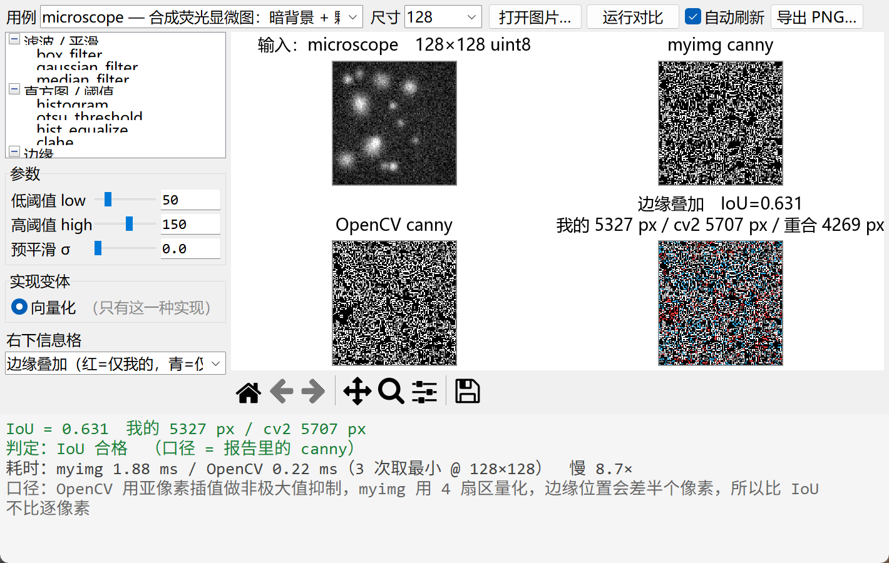
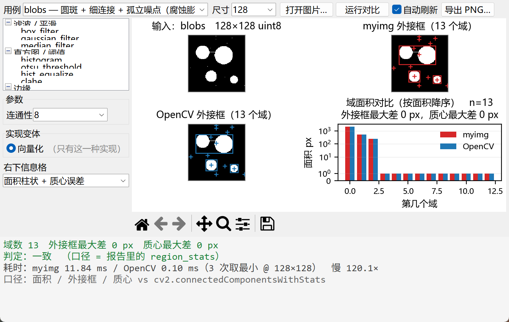

# myimg

纯 NumPy 手写常用图像处理算子，逐个与 OpenCV / scikit-image 对拍，把误差、耗时、差异原因都记下来。

## 为什么做这个

硕士课题的图像预处理流程我走通了，但有些算子属于「会调、说不清里面在算什么」。
这个仓库就是把它们拆开重写：高斯滤波到底怎么卷的、Otsu 的类间方差在遍历什么、
Canny 的非极大值抑制为什么要对幅值插值。写完再跟工业标准库对拍，
误差对不上就必须找到原因，不许用「差不多就行」糊过去。

不是想替代 OpenCV——手写版慢一个数量级是常态，报告里的耗时表就是用来记录这个差距的。
目的是把每个算子的原理和实现细节钉死，被追问的时候答得上来。

## 目录

```
myimg/            算子实现（手写区，只允许 numpy + 标准库）
  _core.py        dtype 归一、边界填充、输入校验（基础设施，已写好）
  filters.py      高斯 / 均值 / 中值滤波
  histogram.py    Otsu 阈值 / 直方图均衡 / CLAHE
  edges.py        Sobel / Canny 简化版
  morphology.py   腐蚀膨胀开闭 / 连通域标记
tests/            pytest：契约测试 + 与 OpenCV 的数值对拍
benchmarks/       对拍运行器与报告模板（cv2 / skimage 只在这里当基准）
  cases.py        12 个固定种子合成用例（含荧光显微合成图）
  refs.py         基准封装，所有口径换算集中在这一个文件
  run_compare.py  跑对拍 -> out/compare.md + compare.json + 对比图
  report_template.md  机器出数字、人写归因，各占一半
examples/cli.py   命令行入口（PIL 只读写图片，碰不到任何算子数值）
gui/              可视化对拍台（Tkinter + matplotlib，应用层，允许用 cv2 当基准）
  params.py       每个算子在界面上暴露哪些可调项（唯一事实源）
  engine.py       调 myimg / OpenCV；误差与判定复用 benchmarks，不重写口径
  render.py       2x2 四格渲染，右下信息格看「差在哪、差多少」
  app.py          窗口 / 控件 / 事件；python -m gui 启动
notes/            报错本、默写记录
data/             真实图片放这里（已 gitignore，只留 README）
PROGRESS.md       验收清单 + 面试复述清单
```

## 手写纪律

1. `myimg/` 下的算子文件**禁止** import `cv2` / `scipy.ndimage` / `skimage`。库只允许出现在
   `tests/`、`benchmarks/`、`gui/` 里当基准（`examples/cli.py` 的 PIL 只负责读写图片，不参与数值）。
   后三者是应用层：基准和界面本来就该用工业库；`myimg/` 里这一条破了，
   「手写 NumPy 实现」这个说法就不成立了。
2. 每个函数**先写能跑的版本**（双层 for 循环也行），测试转绿之后再改写向量化。
   两版都保留，耗时差写进报告——这本身就是报告里的一节。
3. 对不上的误差不跳过，去 `benchmarks/report_template.md` 的「差异归因」里写清楚原因。
4. 每写完一个算子，48 小时内合上资料默写一遍核心实现，记到 `notes/默写记录.md`。
   默不出来 = 没会，回去重写。

## 快速开始

```bash
pip install -e ".[dev]"

pytest -q                       # 全部：未实现的显示 xfail，实现错的显示 failed
pytest tests/test_filters.py -k gaussian   # 单个算子
python benchmarks/run_compare.py --all --figures   # 误差表+耗时表+对比图
python examples/cli.py demo canny --case microscope --sigma 1.4 -o out.png
python -m gui                     # 可视化对拍台（见下节）
```

报告在 `benchmarks/out/compare.md`：误差表、耗时表、差异归因、已核对的口径事实四节。
每个数字都能在 `compare.json` 里找到出处；人写的那一半用 `benchmarks/report_template.md`。

测试结果的三种状态是有意的：

| 状态 | 含义 |
|---|---|
| `xfailed` | 函数体还是 `NotImplementedError`，没开始写 |
| `failed` | 写了，但和基准对不上——去查边界处理、核归一化、dtype |
| `passed` | 对上了，可以去默写一遍 |

## 可视化对拍台（GUI）

```bash
python -m gui
```

Tkinter + matplotlib，零额外依赖（tkinter 是标准库，matplotlib 已在 dev 依赖里）。
界面分四块：顶部工具条（用例 / 尺寸 / 打开本地图片 / 导出）、左侧算子树 +
动态参数滑块 + 实现变体（vector / naive / 积分图）、右侧 2×2 画布、底部状态区
（误差 / 耗时 / 口径说明 / 坑提示）。





设计上有两条硬规矩：

1. **判定口径不重写**。界面上的「逐像素精确 / 超出容差 / 仅记录」全部走
   `benchmarks.run_compare.compare_one`，和 compare.md 是同一套代码算出来的，
   不允许出现「报告说通过、界面说不通过」。
2. **右下信息格是重点**。前三格看效果，第四格看「差在哪、差多少」：
   边缘叠加（红=仅我的、青=仅 cv2、白=重合）、差值热图、Otsu 直方图带阈值线、
   均衡化 CDF、连通域面积柱状 + 质心误差。参数改完 150ms 防抖自动重跑。

回归测试在 `tests/test_gui_engine.py`：参数表 key 与 myimg 签名逐条对齐、
全算子 × 默认参数 engine 不抛异常、全信息格视图 render 不崩（Agg 后端，不弹窗）。

## 对标口径（2026-10-18 本机实测，numpy 1.26.4 / opencv-python 4.10.0 / scikit-image 0.25.2）

对拍之前先把口径对齐，否则误差全是自己造的：

**边界模式三家命名不一致**

| `np.pad(mode=)` | `cv2` borderType | `scipy` / `skimage` mode |
|---|---|---|
| `reflect` | `BORDER_REFLECT_101` | `mirror` |
| `symmetric` | `BORDER_REFLECT` | `reflect` |
| `edge` | `BORDER_REPLICATE` | `nearest` |
| `wrap` | `BORDER_WRAP` | `wrap` |
| `constant` | `BORDER_CONSTANT` | `constant` |

scipy 的 `reflect` 指的是**含边缘**的对称填充，跟 numpy 的 `reflect` 不是一回事。踩过一次就记住了。

**已实测的换算关系**

- 可分离高斯（`np.convolve` 时核要反转）对 `cv2.GaussianBlur(..., borderType=BORDER_REFLECT_101)`：最大绝对误差 `5.68e-14`，可以当完全一致。
- `cv2.getGaussianKernel(7, 2.0)` = `[0.070159, 0.131075, 0.190713, 0.216106, 0.190713, 0.131075, 0.070159]`，不是直接套一维高斯公式，OpenCV 内部有自己的归一化和取整。
- `skimage.sobel(img / 255.0)` == `cv2 幅值 / 255.0 / (4 * sqrt(2))`，精确到 `1.8e-16`。skimage 把平滑核除了 4、求导核除了 √2。
- `cv2.equalizeHist` 与 `skimage.exposure.equalize_hist * 255` 最大差 `1.657` 灰阶 → 对拍取 ±2 容差。
- `cv2.medianBlur` 的边界是 REPLICATE，不是 reflect。
- Otsu：`cv2.threshold(..., THRESH_OTSU)` 与 `skimage.filters.threshold_otsu` 在随机图上都给 125，但两者平局时的取值约定不同，对拍留 ±1 灰阶。
- `cv2.erode` 默认边界值是 `+inf`，`cv2.dilate` 默认是 `-inf`（不是 0）。手写时腐蚀要 pad 大值、膨胀要 pad 小值，否则边缘一圈必错。
- `cv2.boxFilter` **不接受** `BORDER_WRAP`（实测抛 cv2.error）。要对拍环绕边界只能 numpy 先补再常数边界均值。
- OpenCV 高斯的自动核尺寸是 `2 * floor(4σ + 0.5) + 1`（±4σ），不是网传的 ±3σ；`_core.py` 和 `filters.py` 的注释里有命中表。
- `cv2.Canny` 只收 CV_8U 且没有 sigma 参数，工业链路是 `GaussianBlur(uint8) -> Canny`，
  那条链路的 uint8 取整让「带预平滑的 Canny」没法逐像素对拍，只记录 IoU。
- Otsu 在全部 12 个用例上和 cv2 **完全相等**；测试仍留 ±1 容差是给平局约定分叉留的余量。

## 进度

见 [PROGRESS.md](PROGRESS.md)。

## License

MIT
